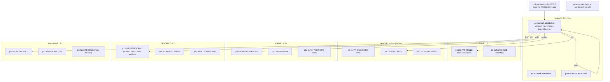
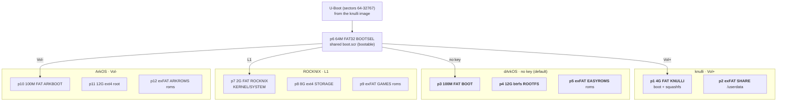
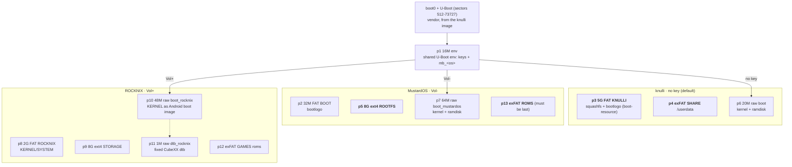

# Partition layouts

The card each device gets with all its OSes, from `--plan` (G350 and RGB30 on a 128 GB
card, CubeXX on 64 GB). ROM partition sizes grow with the card. Fewer OSes keep the same
order but leave partitions out; run `--plan` for your exact layout. Arrows show what
U-Boot reads to start each OS; **bold** partitions sit at numbers the OS hard-codes.

## G350 (MBR): 6 OSes, default dArkOS

With ROCKNIX on the card, U-Boot comes from the ROCKNIX image and runs `boot.scr`;
without it, dArkOS's U-Boot runs `boot.ini`. Without AmberELEC, p1 is a 64M `BOOTSEL`.

- AmberELEC must be p1-p3: its initramfs mounts p3 as ROMs. knulli must be p5/p6 (SHARE =
  boot + 1, one digit). MustardOS ROMS must be last (its factory reset grows it).
- AmberELEC and ROCKNIX boot by filesystem UUID (both have an ext4 `STORAGE`), the others
  by PARTUUID or label.

## RGB30 (GPT): 4 OSes, default dArkOS

U-Boot always comes from the knulli image; it boots `boot.scr` from `BOOTSEL`, the only
partition marked bootable.

- dArkOS must be p3/p4/p5: its initramfs hard-codes `/dev/mmcblk1p4`. knulli must be
  p1/p2. ArkOS's initramfs is patched to follow `root=`, so it can go last.

## RG CubeXX (GPT, 16 entries): 3 OSes, default knulli

The vendor U-Boot from the knulli image finds partitions by GPT name. The shared `env`
partition holds the multi-boot (`boot_normal` reads Vol+/Vol- and runs the chosen OS).
Sectors 16-511 are zeroed (the boot ROM tries sector 16 first).

- knulli's ramdisk hard-codes p3 (SHARE = p4) and MustardOS's p5. The default OS's boot
  image is named `boot`, the others `boot_<os>`; partition names, not numbers, follow the
  default.
